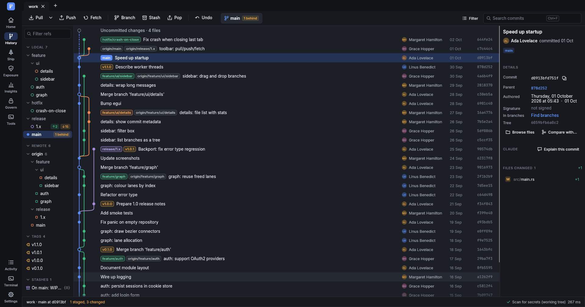
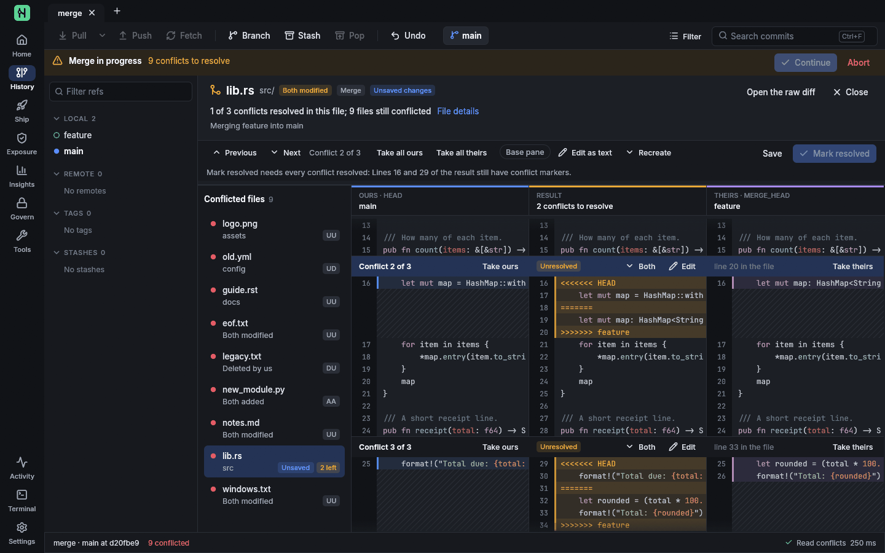

# gitvis

A fast, native Git client focused on **branch visualisation and management**, with the
work around a repository (reviews, CI, releases, deployments, security) in the same window.
Written in Rust with [egui](https://github.com/emilk/egui); an open-source alternative to
GitKraken.

- Reads repositories through **libgit2** (in-process, no shelling out for the graph).
- Runs every mutation through the **real `git` binary**, so hooks, signing,
  credential helpers, LFS and your config behave exactly as on the command line.
- Handles large histories: 50 000 commits are laid out in well under a second;
  rows are virtualised, so scrolling a 100k-commit repository stays smooth.
- Refreshes automatically when the working tree or `.git` changes.





## Install

**Windows** (x86-64): download the installer or the zip from
[Releases](https://github.com/saziknows/hadion-gui/releases). The installer is per-user and
needs no administrator rights; installed that way, gitvis can update itself (Settings →
Updates). Each release lists SHA-256 checksums in `SHA256SUMS`.

gitvis needs `git` on `PATH`. Everything else is optional and only used by the features that
need it: [`gh`](https://cli.github.com/) for GitHub (gitvis uses your `gh auth` and stores no
GitHub token), `glab` / `az` for GitLab and Azure DevOps, `kubectl`, `terraform` / `tofu`,
`act`, `trivy` / `grype`, `pre-commit`, `semgrep`, `curl` for osv.dev and the Claude API, and
Claude Code (`claude`) for AI assist on your Claude plan. A
missing tool is reported where it is needed, with how to install it.

**Platforms.** gitvis is developed and used every day on Windows 11. Linux builds and passes
the test suite (CI runs it on every push), but its UI has seen little use there. macOS has
not been tried yet.

## Build and run

Requirements: a current stable Rust toolchain (edition 2024; developed with 1.97), a C
compiler for libgit2 (MSVC or MinGW on Windows, gcc or clang elsewhere), and `git` on `PATH`
at runtime. On Linux the keychain support also needs `pkg-config` and `libdbus-1-dev`.

```sh
cargo run --release -p gitvis -- path/to/repo
```

Run without arguments inside a repository to open it, or open one from the
welcome screen (`Ctrl+O`).

Tests:

```sh
cargo test
```

Packaging (Windows): `./scripts/package.ps1` builds the release exe, a zip, `SHA256SUMS` and,
when Inno Setup is installed (`winget install JRSoftware.InnoSetup`), a per-user installer
(`packaging/windows/gitvis.iss`, no admin rights). Pushing a tag `vX.Y.Z` that matches
`Cargo.toml` runs `.github/workflows/release.yml`, which builds and uploads the same files;
`.github/workflows/ci.yml` checks format, clippy and tests on pushes and pull requests.
In-app updates need a per-user install (`%LOCALAPPDATA%\Programs\gitvis`).

The integration tests build throwaway repositories with the real `git` binary.
`GITVIS_TIMING=1` prints loader phase timings to stderr;
`cargo run --release -p gitvis-core --example bench -- path/to/repo` times a load;
`--example scan -- path/to/repo [--history N]` prints the exposure report,
`--example osint -- path/to/repo [--unreachable]` the OSINT report and
`--example insights -- path/to/repo [--commits N] [--weight] [--lost] [--date-debt] [--pickaxe TEXT]`
the insights report.

Third-party licences: `cargo run -p gitvis-core --example notices` writes the licence texts of
every crate compiled into gitvis; `scripts/package.ps1` puts them in
`licenses/THIRD-PARTY-LICENSES.txt` of every release.

## Features

**Graph**
- Lane layout with colour-stable branches, merge rings, HEAD marker and a dashed
  "uncommitted changes" row.
- Ref pills on commits (local / remote / tag), with overflow folding.
- Search commits, authors, SHAs and ref names (`Ctrl+F`, `Enter` / `Shift+Enter` to step).
- Keyboard navigation (`↑` / `↓`), click to inspect, right-click for actions.
- Hide individual refs from the graph, show a single branch ("solo"), hide all remotes or tags.
- **Multi-select**: `Ctrl+click` toggles a commit, `Shift+click` picks a range. The details
  panel then lists the picked commits (files, lines, authors, span) and offers compare
  oldest with newest, cherry-pick onto the current branch, create patch files, and squash /
  reword / drop through the interactive rebase. Actions that cannot run say why.
- **Filter bar** (the Filter button beside the search): author, path, date range and
  message. Rows that do not match are dimmed ("312 of 50,000 commits match", previous / next
  match); path and message queries run one streamed, cancellable `git log --all`.
- **Signatures**: the visible rows are verified lazily and get a shield badge; the commit
  panel shows kind, signer, key, fingerprint and trust, with the commands that fix a
  missing allowed-signers file or an unknown GPG key.

**Branches & refs**
- Sidebar tree for local branches, remotes, tags and stashes with a filter box.
- Create / rename / delete branches, create and delete tags, push tags.
- Checkout local branches, check out remote branches as tracking branches.
- **Drag a branch onto a commit or branch** to merge or rebase.
- Merge (default / no-ff / ff-only / squash), rebase, cherry-pick, revert, reset (soft / mixed / hard).
- Fetch, pull (merge / ff-only / rebase), push with upstream setup and `--force-with-lease`.
- In-progress merge / rebase / cherry-pick / revert / `git am` banner with Continue, Skip,
  Abort.
- Branch, remote branch and tag menus: compare with HEAD or anything else, browse the files,
  blame.

**Working tree**
- Staged / unstaged / conflicted lists with per-file stage, unstage, discard, delete.
- **Merge conflict editor**: click a conflicted file. Ours | result | theirs, with an
  optional base pane, sharing one scroll and syntax colours; per conflict take ours,
  theirs, both (either order), base, or edit the text; `Alt+↓` / `Alt+↑` move between
  conflicts, `Ctrl+S` saves, **Mark resolved** (`git add`) once no markers remain.
  Understands merge, diff3 and zdiff3 markers and custom marker sizes, keeps CRLF and a
  missing final newline, fills in the base of merge-style files from the index stages,
  explains the swapped sides during a rebase, and offers a choice card with the exact
  commands for binary, delete/modify, add/add and both-deleted conflicts.
- Commit, amend, stash (with untracked), apply / pop / drop stashes; **stash selected files**
  ("Stash this file…" in the file menu); **split a commit** ("Split this commit…" in the
  commit menu: `git reset HEAD~`, or an `edit` rebase for an older commit).

**Diff viewer**
- Unified or **side-by-side**, syntax colouring (syntect), **word-level change emphasis**.
- Stage / unstage / discard **per hunk or per selected lines** (click, shift-click, drag);
  patches are built byte-exact and applied with `git apply`.
- Ignore-whitespace toggle, adjustable context, copy line / selection / hunk, open file,
  reveal in Explorer.

**Activity, reflog, undo**
- Activity panel (`Ctrl+L`): everything gitvis did, with the exact command, the full
  output, working directory, size and duration. Filter by kind (operations, repository
  reads, GitHub API) or text; copy commands or output.
- **Verbose mode** (on by default, gear menu): background reads are logged too — what a
  repository load found (commits, refs, status, lanes, time), every `git diff` with its
  hunk/line counts, every `gh api` request with bytes, latency and the remaining rate limit.
- Reflog tab with old → new SHAs, exact times, jump-to-commit, branch-from-here and hard reset.
- **Undo** (`Ctrl+Z`): derived from the reflog — undo commit/amend (soft reset keeps the
  changes staged), checkout, merge, pull, rebase, reset, cherry-pick, revert. Destructive
  undos ask first.
- Status bar: HEAD and upstream, counts, load time, working-tree state, GitHub summary,
  API budget, and the last thing that ran.

**Home** (`Ctrl+Shift+H`): every open repository at a glance and your GitHub inbox
- One card per open repository: branch with ahead / behind, staged / changed / untracked /
  conflicted counts, stashes, CI on HEAD, open pull requests and yours, failed runs on your
  branches, urgent exposure findings, operations in progress. **Fetch all** runs
  `git fetch --all --prune` in each repository after a confirmation listing them.
- **Inbox**: notifications by reason (review requested, mention, assigned, CI, security, …)
  with unread / open-in-gitvis / group-by-repository filters, plus review requests, your
  pull requests, mentions and assignments from one GraphQL search, and failed runs on your
  branches from the data already loaded. Items open in gitvis when their repository is open.
- **Groups**: named sets of repositories (open or not) with a status table (branch, ahead /
  behind, changes, last commit), open all as tabs, and **fetch all / pull all (`--ff-only`)
  / create a branch in all**, one repository after another with the result of each; pull
  skips dirty, detached, diverged and untracked branches and says so.

**Review** (`Ctrl+Shift+R`): pull requests and issues (through the `gh` CLI, so gitvis stores no token)
- Pull request list from one GraphQL query: draft, review decision, checks, conflicts or
  behind, your review requested, labels in their colours; chips for open / draft / review
  requested / mine / closed, search, paging.
- Conversation with the description, timeline and a comment box, and a **merge box**:
  mergeability explained, only the merge methods the repository allows, commit title and
  message, delete branch, **auto-merge**, update branch, ready for review / draft,
  close / reopen, check out locally.
- **Review in the diff**: changed files with viewed marks, syntax-coloured patches with both
  line numbers, review threads under their lines (resolve / unresolve, reply), select a line
  or range to comment, **suggest a change**, pending comments submitted as one review
  (comment / approve / request changes). Commits and checks tabs.
- **New pull request** inline: base and head, push state ("push first"), PR template (or a
  chooser), a body generated from the commits, reviewers, teams, assignees, labels, draft.
- **Issues**: list with filters and labels, detail with comments, comment / close (completed
  or not planned) / reopen, edit labels and assignees, new issue with templates, **start a
  branch** `N-slug`, "Fixes #N", and the commits in the graph that mention the issue.
- Every change shows the exact `gh api` requests and JSON bodies before it runs.

**Actions** (`Ctrl+Shift+G`): workflow runs and CI control
- **Runs**: the latest 100 runs with status, title, workflow, event, branch, actor, age and
  duration; filter by text or status; pick several for **bulk cancel / re-run**; per run
  re-run all or failed jobs (optionally **with debug logging**), re-run one job, cancel,
  force cancel, cancel everything running on a branch, delete logs or the run. Jobs, steps
  with their share of the time, annotations, artifacts, and the **full job log** (foldable
  groups, ANSI colours, timestamps, filter, jump between errors).
- **Compare with the last green run**: commits and files in between, and a normalised log
  diff of each failing job (first divergence, lines only in the failing run, hunks).
- **Workflows**: every workflow with its last 100 runs, success rate, median and p90
  duration, queue time, a duration trend chart, runs by branch and event, flaky signs, and
  on demand a per-job analysis across attempts; enable / disable; **run a
  workflow_dispatch workflow** with a form built from its typed inputs.
- **Artifacts** (sizes, expiry, download into a folder, delete) and **caches** (usage against
  the 10 GB limit, by key or ref, delete, clean up caches of closed pull requests).
- **Validate**: lint every workflow file (YAML errors, unknown events and contexts, broken
  `needs`, cycles, unbalanced expressions, deprecated actions and commands, unpinned actions,
  `pull_request_target` pitfalls, missing permissions and timeouts, cron, dispatch inputs)
  with lines and fixes, merged with `actionlint` when installed.
- **Run locally** with `act` (jobs, event, inputs, image, a secrets file by path).
- **Checks on any commit** in the details panel (check runs and commit statuses), the CI dot
  in the graph, and "Open on GitHub" on commits, branches and runs.

**Ship** (`Ctrl+Shift+D`): releases, deployments and what is running
- **Releases**: list with assets and download counts, download an asset, edit, delete, and
  **publish** a release with a suggested next version (from conventional commits), notes
  generated by GitHub or grouped locally, draft / pre-release / latest, and assets
  (`gh release create`).
- **The release commit** (in the publish form): bump the version in package.json,
  Cargo.toml (package and workspace), pyproject, csproj, pom.xml, Gradle, VERSION and
  Chart.yaml without touching their formatting, add a Keep a Changelog section to
  CHANGELOG.md (compare links included, Unreleased entries moved in), then one local commit
  of only those files after a confirmation with the exact diffs.
- **Environments**: what is deployed where (commit, ref, when, by whom, commits behind the
  default branch, what staging has that production does not), deployment history, **pending
  approvals** (approve / reject with a comment), **promote** and **roll back** by re-running
  the deploying run or creating a deployment.
- **Where is my commit**: authored and committed, the pull request that brought it in,
  branches, the first tag and releases that contain it, checks, and each environment it has
  reached (and since when). Also in the commit context menu.
- **DORA metrics** from deployments, releases, tags or workflow runs over 30 / 90 / 180 days:
  deployment frequency, lead time for changes, change failure rate and time to restore, with
  performance bands, weekly charts, the method and the data coverage.
- **Packages**: container images on GitHub Packages with their tags matched to commits,
  tags, branches and pull requests, `docker pull` lines, delete a version (needs the
  `read:packages` / `delete:packages` scopes; the page shows the `gh auth refresh` command).
- **Kubernetes** through `kubectl` (any context, never switched): workloads with rollout
  state and the commit each image runs, pods with restarts and last termination, events,
  rollout history, streamed logs; restart, undo and scale after a confirmation.
- **Terraform / OpenTofu**: roots and modules, the roots your changes touch, fmt check,
  init (`-backend=false`), validate with file and line, plan with a resource table, and
  drift checks. Nothing is ever applied.

**Govern** (`Ctrl+Shift+A`): security and administration
- **Dependabot and code-scanning alerts**: severity tiles, details (CVSS, CWE, EPSS),
  fix guidance from the local lockfile, the Dependabot pull request, the flagged code;
  dismiss with a reason or reopen.
- **SBOM** from the lockfiles, exported as CycloneDX 1.5 or SPDX 2.3, compared with
  GitHub's dependency-graph SBOM.
- **Container images**: Dockerfile lint (unpinned or `latest` bases, root user, `ADD` URLs,
  `curl | sh`, package-manager hygiene, secret-looking `ENV` / `ARG` names, cache busting, …),
  compose images, and scans with `trivy`, `grype` or `docker scout` in the console.
- **Branch protection** as a form (reviews, status checks, linear history, force pushes,
  conversation resolution, lock), rules in effect and rulesets.
- **CODEOWNERS**: GitHub's matching (last rule wins), validation, GitHub's own errors, rules
  that never decide or match nothing, "who owns this path", coverage and unowned
  directories, and an editor.
- **Environments** (reviewers, wait timer, branch policies), **Actions secrets** (values go
  only to `gh secret set` on standard input and are never shown or logged) and
  **variables**, per repository and environment.

**Tools** (`Ctrl+Shift+T`): the daily workflow
- **Tasks** discovered from package.json (with the right package manager), Makefile,
  justfile, Taskfile, Cargo, composer, deno, Go, .NET, Gradle, Maven, Python and docker
  compose; run them in the console with extra arguments, history and favourites.
- **Console**: every streamed process (tasks, `act`, `kubectl logs`, `terraform`, scans,
  `git bisect run`) with its command, status, duration, Stop and Run again.
- **Interactive rebase** without an editor: pick / reword / edit / squash / fixup / drop,
  reorder by drag or keys, combined squash messages, a preview and a warning for pushed
  commits. Also "Interactive rebase from here…" in the graph.
- **Bisect** by hand (good / bad / skip) or with a test command (`git bisect run`), with the
  steps left, the tested commits and the first bad commit.
- **Worktrees**: list with state, open as a tab, add, lock, move, remove, prune.
- **File history** across renames, with each commit's diff of the file; also "File history"
  in the file menus.
- **Stashes**: each stash's files and diff, apply / pop (optionally `--index`), drop, branch
  from it, and a form that stashes only the files you tick.
- **Submodules**: recorded and checked-out commits, changes inside, ahead / behind, a changed
  URL that needs a sync; init, update, sync, update to remote, open as a tab, add, deinit
  and remove.
- **Git LFS**: tracked patterns (track / untrack, lockable), files with size and whether
  they are downloaded, `git lfs status`, locks (on request; lock and unlock are remote
  writes), pull, fetch, prune with a dry run, `install --local`.
- **Patches**: create from the last N commits or a range; apply with a preview per file
  ("applies cleanly", "needs a 3-way merge", "does not apply") through `git apply` or
  `git am`, with Continue / Skip / Abort while `git am` is stopped.
- **Hooks**: every hook in `core.hooksPath` or `.git/hooks` with when git runs it; edit,
  enable / disable, new from a template. **The gitvis secret check** installs as a
  pre-commit hook (`gitvis hook pre-commit`, chaining an existing hook): it scans the
  staged added lines with the Exposure rules, prints findings redacted, and stops the
  commit on a high or critical one that you did not dismiss (`git commit --no-verify`
  skips it once). `pre-commit` and `semgrep` run in the console when installed.

**GitLab and Azure DevOps**
- Repositories whose remote is on GitLab (`glab api`, self-hosted hosts included) or Azure
  DevOps (`az` with the azure-devops extension) get the Review and Actions pages for merge
  requests / pull requests (create, merge or complete, approve, vote, comment) and
  pipelines (jobs, stages, foldable logs, retry, cancel, run with variables). Public
  gitlab.com projects can be read without signing in.

**Compare** ("Compare …", "Browse files" and "Blame" in the commit, branch and tag menus,
the multi-selection panel, or the palette's `>compare`)
- Any two refs, commits or the working tree, as `A..B` or `A...B`: merge base, commits only
  on each side, files with renames and mode changes, and a syntax-coloured diff.
- **Files at a commit**: the folder tree with sizes and a fuzzy search, each file's content,
  and buttons for blame, file history and compare with the working tree.
- **Blame**: `git blame -w -M -C` with an age bar, the commit of each run, and "blame the
  previous version" that keeps the line in view.

**Command palette** (`Ctrl+K` or `Ctrl+Shift+P`)
- One fuzzy search over commands (about 110: every page, tab and setting, git actions),
  branches and tags (`@`), pull requests and issues (`#`), files of HEAD (`/`), commits
  (`:`), runs (`!`) and repositories (`~`); `?` lists the prefixes.
- `Enter` runs the default action, `Ctrl+Enter` or right-click lists all of an item's
  actions, `Tab` narrows to a kind or completes. Recent items rank higher (one-week
  half-life, per repository). Merge and rebase still ask first; executable files are shown
  in their folder, never run.

**Terminal** (`` Ctrl+` ``, or the rail's Terminal entry)
- A real pseudo-terminal (ConPTY on Windows) in a bottom panel with tabs per shell: pwsh,
  Windows PowerShell, cmd, Git Bash, each WSL distribution, or `$SHELL`, started in the
  active repository's folder.
- 16 / 256 / true colour, bold, italic, underline, inverse and dim; its own scrollback
  (10,000 lines by default); selection, copy and paste; mouse reports for full-screen
  programs; "Go to repository" types the right `cd`.
- While it has focus every key goes to the shell (`Ctrl+K`, `Ctrl+L`, `Ctrl+Z`, `Ctrl+W`,
  Tab, arrows); only `` Ctrl+` `` hides the panel. `Ctrl+C` copies a selection, otherwise
  it interrupts.

**AI assist** (your Claude Code or the Claude API; Settings → AI assist)
- Write the commit message from the staged diff, write a pull request description, explain
  a failed CI job from its log, summarise a pull request (risky areas, questions for the
  author), and explain a commit with a risk badge.
- Two ways to Claude: **Claude Code**, your own `claude` CLI signed in with your Claude plan
  (requests count against the plan's limits instead of a per-token bill), or the **Claude
  API** with an API key (billed per token). **Auto**, the default, uses Claude Code when it is
  signed in with a plan, otherwise the API key, and otherwise says how to set up either.
  Model and effort are chosen per way and per feature.
- gitvis runs Claude Code from an empty folder with its tools, MCP servers, plugins, hooks,
  slash commands and CLAUDE.md files off (`--safe-mode --tools ""`), for one turn, without
  saving the session. The material goes on standard input, never on the command line, and
  `ANTHROPIC_*` / `CLAUDE*` variables are removed so it uses its own sign-in. gitvis never
  reads or stores Claude Code's credentials: it reads `claude auth status`, shows how to
  install Claude Code or sign in (`claude auth login`, which you run yourself), and warns
  when Claude Code is signed in with an API key, which bills that account.
- Runs only when you click. A confirmation shows the exact `claude` command line or API
  request, the model, effort, size, estimated tokens and API cost, the sources and files, and
  what was redacted, before anything is sent. Secrets found by the Exposure rules are
  replaced with `[REDACTED:<rule>]`, private-key blocks and files such as `.env` are left
  out, and large inputs are cut to the budgets you set.
- The API key lives in the OS keychain (or `ANTHROPIC_API_KEY`) and reaches `curl` on
  standard input only. Answers stream in; refusals, `max_tokens`, rate and plan limits (with
  reset times), retries and model fallbacks are shown as such, and Stop ends a request. The
  session usage table lists requests and tokens per way, model and feature, with the
  estimated cost of API requests; Claude Code's own estimate is shown as covered by your
  plan.

**Settings** (`Ctrl+,`, the gear on the rail)
- **Appearance** and **Behaviour**.
- **Safety**: **safe mode** refuses every change outside this machine before it starts:
  `git push`, GitHub / GitLab / Azure writes and GraphQL mutations, `gh` subcommands that
  write, LFS locks, kubectl / helm / terraform / docker push. Reads and local git changes
  stay possible; task scripts and commands typed in the terminal are not covered.
- **Git config**: the common settings with explanations, git's default, a recommended value
  and warnings; every entry with scope, file and line and what overrides it; the files git
  read. Edit or unset in global or local scope with the exact `git config` command.
- **Identities**: every `includeIf` rule with the name, e-mail and signing key it applies,
  warnings for rules that never match, "which identity applies" for any folder; add, edit
  and remove identities.
- **Keys and signing**: SSH keys (fingerprints, agent state, the GitHub `ssh -T` test,
  generate), GPG keys, set up SSH or GPG signing, upload a key to GitHub.
- **GitHub account**: `gh auth status` per host, rate limits, the scopes each feature needs
  with the `gh auth refresh` command, switch account, `gh auth setup-git`.
- **Notifications** (off by default): desktop notifications for finished or failed runs,
  review requests, mentions and deployment approvals, polled every 2 to 15 minutes while
  the API budget allows, with quiet hours; a bell in the status bar lists them.
- **Integrations**: Jira, Linear and custom issue-key links as chips in the commit panel,
  pull requests and the WIP panel ("Add ABC-123" to the message), with optional title and
  status lookups (tokens in the keychain).
- **Updates**: check GitHub releases when asked (or on start), verify the SHA-256, stage the
  new exe and swap it in on restart, rolling back on failure.
- **Crash reports**: written with secrets removed to `%LOCALAPPDATA%\gitvis\crashes`,
  offered on the next start, never uploaded; "Report on GitHub" shows the issue text first.
- **About**: version, commit, build, paths and licences.

**Exposure: is the repository leaking anything?** (`Ctrl+Shift+S`, or the Exposure button)
- **Secrets in content**: 50+ patterns (AWS, GitHub, GitLab, Slack, Stripe, Google, OpenAI,
  Anthropic, npm, PyPI, Azure, private keys, JWTs, passwords in URLs, credentials in
  `.env`/ini/yaml, generic `password =` assignments, high-entropy strings) with placeholder
  and entropy filters; a `gitvis:allow` comment on a line skips it.
- **Sensitive files**: `.env*`, SSH and PGP keys, `*.pem/.key/.p12/.pfx/.jks`, credential
  stores (`.git-credentials`, `.netrc`, `.npmrc`, `.pypirc`, `.aws/credentials`, kubeconfig,
  Docker config), Terraform state and variables, database dumps, shell histories, …
- **Where it is**: in the working tree, **staged** (would go into the next commit), in
  **HEAD**, or **only in history** (committed and removed again, still in every clone);
  the commit that introduced it (`git log -p -U0`, added lines only, newest N commits or
  the entire history, HEAD or all refs); and whether it was **pushed** (reachable from a
  remote-tracking branch). Occurrences link to the diff or the commit.
- **Configuration**: passwords embedded in remote URLs (one click to strip them), plaintext
  credential helper, disabled TLS verification, missing `.gitignore`.
- **GitHub**: public or private, forks, whether secret scanning and push protection are on,
  and open secret-scanning alerts.
- **What to do**: per finding, numbered steps with buttons: open the provider's key page,
  open or unstage the file, stop tracking (`git rm --cached`), add to `.gitignore`, copy a
  `git filter-repo` command to purge it from history, dismiss as a false positive
  (remembered per repository).
- **Before every commit** the staged changes are checked; flagged files get a red shield in
  the working-tree list, and the commit button asks before committing a possible secret.
- Secrets never appear on a command line or in the activity log; the log records counts,
  paths and the git commands that ran. Whole-tree scans run on all cores and are gated by
  keyword matching, so a 500 MB tree takes seconds; history is read with `git log -p -U0`.

**Git OSINT: what the repository tells an outsider** (tabs on the Exposure page)
- **People**: every author and committer address with its kind (personal mailbox, corporate
  domain, GitHub noreply, invalid), the names used with it, aliases (same name, other
  addresses), commits authored and pushed, first and last activity, UTC offsets, and a
  weekday × hour heat map per person and for the whole team; warns when your configured
  `user.email` would go into a public repository.
- **Footprint**: infrastructure and personal data named in the files, found with the same
  engine as the secrets but other rules: private and public IPs, internal hostnames, AWS
  account IDs, S3 buckets, GCP projects, Azure subscriptions, private container registries,
  Slack workspaces, local paths with user names, e-mail addresses, phone numbers, IBANs
  (checksum-verified), payment cards (Luhn-verified), US social security numbers.
- **Files**: EXIF in JPEG, PNG and TIFF (GPS position with a map link, camera, owner, serial
  numbers), PDF Info and XMP, Office and OpenDocument properties (creator, last modified by,
  company), absolute build paths inside committed binaries, and junk files from developer
  machines (`.DS_Store`, swap files, logs, crash dumps, IDE workspaces).
- **History**: commit messages that describe security events (removed secrets, leaks,
  disabled checks, hacks, accidents), commits only the reflog still reaches (with a one-click
  check whether GitHub still serves them), stashes with their secrets, backup-looking
  branches, deleted files with sensitive names (with the command that resurrects them),
  `git fsck --unreachable` on demand with a secret scan of the unreachable blobs, the
  pull-request refs the remote advertises, and trailers, ticket keys and URL domains.
- **GitHub**: visibility, forks (and why forks keep purged commits), secret-scanning,
  Dependabot and code-scanning alerts, the admin surface (deploy keys, webhooks,
  environments, Actions secret names, variables, branch protection, collaborators),
  CODEOWNERS, and twelve code-search **dorks** run against the owner with your own account.
- **Supply chain**: dependencies pinned to git URLs (package.json, Cargo, pip, go.mod,
  Gemfile, pyproject), packages from lockfiles checked against **osv.dev** on demand,
  committed hooks (husky, pre-commit), filter and diff drivers, LFS configuration.
- Everything but osv.dev, GitHub and `ls-remote` is local; those run only when asked.

**Insights: what git knows but no client shows** (`Ctrl+Shift+I`, or the Insights button)
- **Health**: checkout landmines (case collisions, Windows reserved names and forbidden
  characters, trailing dots, paths over 260 bytes, Unicode normalisation clashes, symlinks,
  tracked-but-ignored files, huge directories, nested repositories), line endings from
  `git ls-files --eol` (CRLF/LF/mixed, files whose working tree fights the index, BOMs,
  non-UTF-8, misattributed binaries, autocrlf and `.gitattributes` state), executable bits
  (scripts without `+x`, data files with it), repository weight (`count-objects`, largest
  HEAD blobs, bytes by directory and extension, LFS pointers and candidates, commit-graph,
  shallow/partial clone, worktrees, loose vs packed refs, gc advice) and, on demand, every
  object in history (`rev-list --objects --all` through `cat-file --batch-check`: biggest
  blobs ever committed, dead weight no longer in HEAD), plus submodule state.
- **Hotspots**: files ranked by recency-weighted churn with bug-fix share and author count,
  temporal coupling (files that keep changing in the same commits, cross-directory pairs
  marked) and code age per directory, from one streamed `git log --numstat -M` pass.
- **Owners**: lines added per author per directory, bus factor, orphaned directories (one
  owner, gone for a year), and `git blame` of any file on demand (surviving lines by author
  and by year).
- **Branches**: stale, merged, gone and throwaway branches, ahead/behind, unique commits,
  predicted merge conflicts (files both sides changed since the merge base), patches already
  present elsewhere (`git cherry`), switch/delete from the detail.
- **Commits**: hygiene (WIP and fixup commits, reverts and reverts of reverts, giant commits,
  conventional-commit adoption, issue references, merge vs rebase style by year) and
  provenance (signature verification of the newest commits via `%G?`, bots, author ≠
  committer, future / epoch / rebased / backdated / offset-jump dates).
- **Releases**: tags (annotated, signed, orphan), unreleased commits grouped as a changelog
  draft, cadence, version bumps, suggested next version from conventional commits.
- **Timeline**: commits and lines per month with joins and departures, contributors with
  spans, language breakdown, and when work happens (weekday × hour).
- **Debt**: TODO / FIXME / HACK / XXX / BUG / NOCOMMIT markers by directory and assignee,
  dated on demand through `git blame` (who wrote each, how long ago, oldest first).
- **CI**: GitHub Actions workflows parsed for unpinned third-party actions,
  `pull_request_target` with a PR checkout, script injection through `${{ github.event.* }}`,
  missing or `write-all` permissions, secrets passed to third parties, self-hosted runners on
  fork-triggerable workflows, `curl | sh`, missing timeouts, deprecated commands; plus
  secrets, runners, other CI systems, Dependabot and Renovate.
- **Licences**: the project licence (classified), manifest declarations that disagree with
  it, dependency licences found offline (package-lock, node_modules, the local cargo
  registry, vendored trees), copyleft and AGPL dependencies, copyright headers naming other
  holders (copied code).
- **Search**: pickaxe (`git log -S`), diff regex (`-G`), message and author search across
  all refs, with the files each hit touched and a one-click diff.
- **Recovery**: commits and stashes no ref reaches (`git fsck --unreachable --no-reflogs`),
  with reflog provenance and changed files; restore as a branch, cherry-pick, or
  `git stash store`.

**Commit details**
- Author and committer with e-mails and both timestamps (and the delay between them),
  full SHA and tree SHA, signature presence (GPG / SSH / X.509), parents, refs, and
  "in branches" (`git branch --contains`, on demand).
- File list with per-kind counts (added / modified / deleted / renamed / binary) and stats.

**App**
- A navigation rail for the pages of the open repository (Home, History, Review, Actions,
  Ship, Exposure, Insights, Govern, Tools), with the activity log and settings at the
  bottom; a dot marks a page that needs attention (failed runs, review requests, approvals
  waiting for you, critical alerts, running tasks, a rebase or bisect in progress).
- Every change made outside git (GitHub, GitLab, Azure DevOps, kubectl, terraform) is
  confirmed first with the exact command or request, and logged with its request body;
  network calls only happen when you open a page or press a button.
- Multiple repositories as tabs; clone (`Ctrl+Shift+O`), open (`Ctrl+O`), or drag a folder
  onto the window.
- API keys and tokens live in the OS keychain (service `gitvis`), never in settings files or
  logs.
- Inter and JetBrains Mono (both SIL Open Font Licence, bundled in
  `crates/gitvis/assets/fonts` with their licences), dark and light themes, relative or
  absolute dates.
- Settings and per-repository preferences persist between runs.

## Keyboard

| Keys | Action |
| --- | --- |
| `Ctrl+O` | Open repository |
| `Ctrl+W` | Close current tab |
| `Ctrl+F` | Search commits |
| `Enter` / `Shift+Enter` | Next / previous search match |
| `↑` / `↓` | Move commit selection |
| `Esc` | Clear diff selection, then close the diff view / search |
| `Ctrl+Enter` | Commit (while writing the message) |
| `Ctrl+L` | Activity log / reflog panel |
| `Ctrl+Z` | Undo the last HEAD movement |
| `Ctrl+Shift+O` | Clone repository |
| `Ctrl+K` / `Ctrl+Shift+P` | Command palette |
| `` Ctrl+` `` | Terminal panel |
| `Ctrl+,` | Settings |
| `Ctrl+click` / `Shift+click` | Pick commits in the graph |
| `Alt+↓` / `Alt+↑`, `Ctrl+S` | Next / previous conflict, save (conflict editor) |
| `Ctrl+Shift+H` | Home: open repositories and the GitHub inbox |
| `Ctrl+Shift+R` | Review page (pull requests, issues) |
| `Ctrl+Shift+G` | Actions page (runs, workflows, artifacts, caches, validation, local runs); `Esc` returns to the graph |
| `Ctrl+Shift+D` | Ship page (releases, environments, DORA, packages, Kubernetes, Terraform) |
| `Ctrl+Shift+A` | Govern page (alerts, SBOM, images, protection, CODEOWNERS, secrets) |
| `Ctrl+Shift+T` | Tools page (tasks, console, interactive rebase, bisect, file history, worktrees) |
| `Ctrl+Shift+S` | Exposure page (secrets, sensitive files, configuration); `Esc` returns to the graph |
| `Ctrl+Shift+I` | Insights page (health, hotspots, owners, branches, commits, releases, timeline, debt, CI, licences, search, recovery) |
| `F5` | Reload repository |

## Architecture

```
crates/
  gitvis-core/   repository model, graph layout, diff parsing, git operations
    src/graph.rs     lane layout (pure, unit-tested)
    src/repo.rs      libgit2 snapshot loader; `git status` for the working tree
    src/ops.rs       GitOp -> git command lines, run via the git binary
    src/diff.rs      unified-diff parser: raw bytes for `git apply`, line pairing, word diff
    src/reflog.rs    HEAD reflog and the undo derived from it
    src/github.rs    pull requests, runs, jobs, logs, checks via `gh api` (rate limit tracked)
    src/joblog.rs    Actions job-log parser: timestamps, ##[group]/##[error] markers, ANSI
    src/secrets.rs   secret and sensitive-file rules; working-tree, staged and history scans
    src/osint.rs     identities and time patterns, footprint rules, file metadata, history leftovers, supply chain
    src/insights/    health, numstat history analytics, refs, debt, CI, licences, search, recovery
    src/devops/      no-UI DevOps areas: gh.rs (typed gh api, bodies on stdin), proc.rs
                     (streamed processes), tools.rs, review/, ci/, ship/, runtime/, govern/,
                     workbench/, forge/ (GitLab, Azure DevOps), home/, conflict/,
                     history/, gitplus/, ai/, palette/, identity/, terminal/,
                     automation/, packaging/; safety.rs (safe mode), keychain.rs
    tests/           end-to-end tests against generated repositories
  gitvis/        egui application
    src/app.rs       state machine: loads, operations, watcher, actions, verbose logging
    src/worker.rs    background reader thread + one thread per operation or API request
    src/watcher.rs   file-system watcher with .git-aware classification
    src/highlight.rs syntect colouring, computed on the reader thread
    src/script.rs    GITVIS_SCRIPT smoke-test driver (screenshots via egui)
    src/theme.rs     design tokens: palette, type scale, spacing, fonts
    src/views/kit.rs the component kit every page is built from
    src/views/       rail, toolbar, sidebar, graph, details, diff, github, security, osint, insights/,
                     form (inputs), console (process output), activity, …
    src/devops/      one module per DevOps area (state, actions, replies, views), the Ctx
                     command buffer they use, the console, the Ship page navigation,
                     app-wide areas (global.rs), hooks into shared views (hooks.rs),
                     the Settings page
```

The UI never blocks on git: snapshots, details and diffs are loaded on a
reader thread, operations run on their own thread, and results come back as
events. Views emit `Action`s which the app applies after each frame, so views
stay free of orchestration logic. DevOps areas never touch the app directly: their
controllers push effects (GitHub or local reads, changes, console processes, actions) into
a `Ctx`, and their replies come back as messages routed to the same area.

## Status

Early but usable: version 0.1. Not yet implemented: custom secret rules (the rule set is
built in), comments on a whole file or editing existing review comments, Azure DevOps pull
request comments, Bitbucket, Linux and macOS packages.
GitHub, GitLab and Azure DevOps writes are covered by request-builder tests and were
exercised up to their confirmation dialogs; they have not yet been run against a sandbox
repository. The same goes for LFS locks, uploading a key to GitHub and `gh release
download` during an update. AI assist was tested against a fake `curl` and a fake `claude`
(the `fake_claude` example), not the real API; three trivial real Claude Code calls confirmed
its stream format;
`pre-commit` and `semgrep` were not installed while it was built.

## Contributing

Bug reports, ideas and pull requests are welcome; see [CONTRIBUTING.md](CONTRIBUTING.md).
Please report security problems privately, as described in [SECURITY.md](SECURITY.md).
[CHANGELOG.md](CHANGELOG.md) lists what changed in each release.

## License

gitvis is licensed under either of

- [Apache License, Version 2.0](LICENSE-APACHE)
- [MIT license](LICENSE-MIT)

at your option.

Unless you explicitly state otherwise, any contribution intentionally submitted for
inclusion in gitvis by you, as defined in the Apache-2.0 license, shall be dual licensed as
above, without any additional terms or conditions.

The bundled Inter and JetBrains Mono fonts are under the SIL Open Font License 1.1 and the
Lucide icons under the ISC licence (their licences are in `crates/gitvis/assets/fonts`); the crates gitvis is built from keep their own
licences, collected in each release's `licenses/THIRD-PARTY-LICENSES.txt`.
