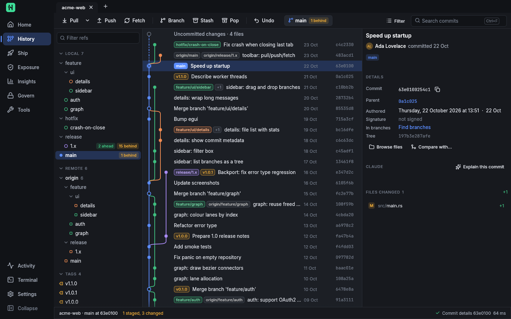
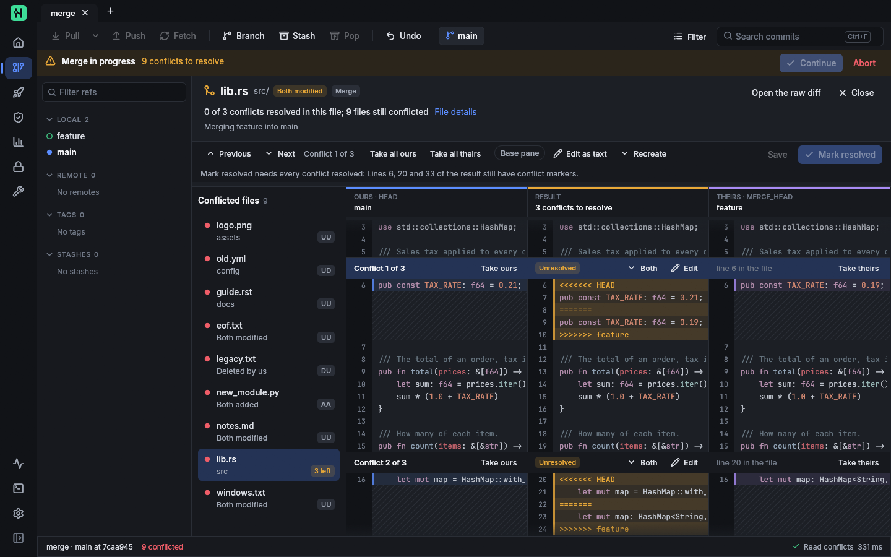
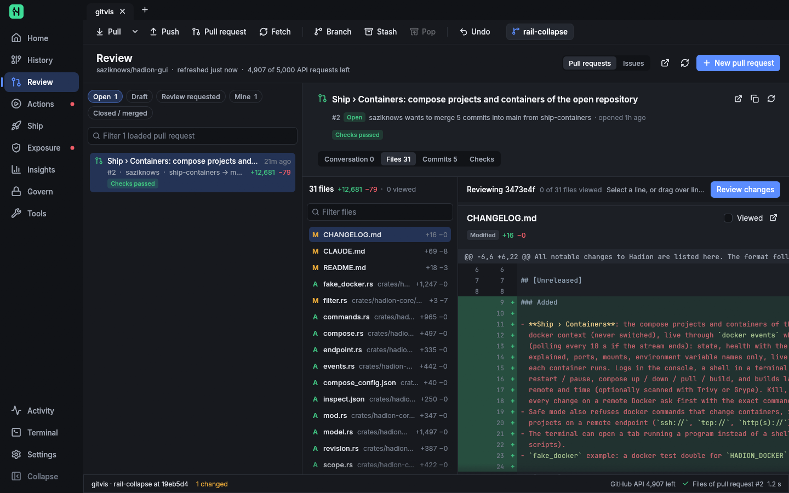
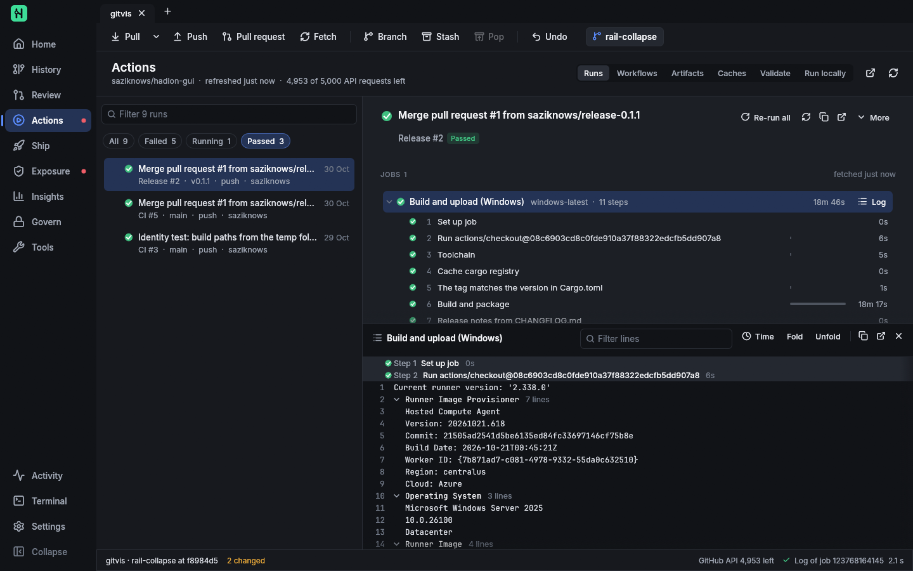
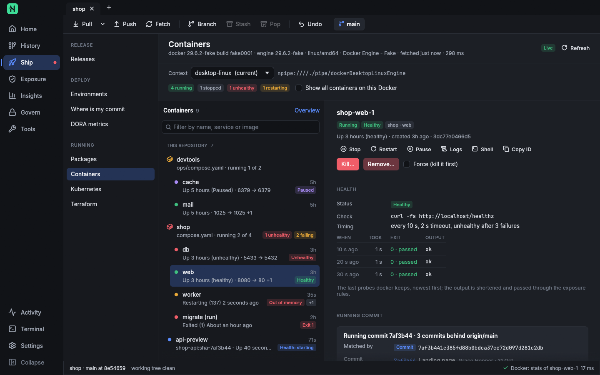
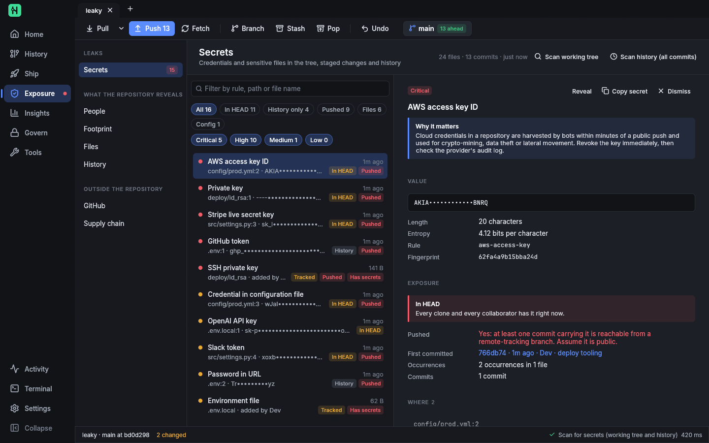
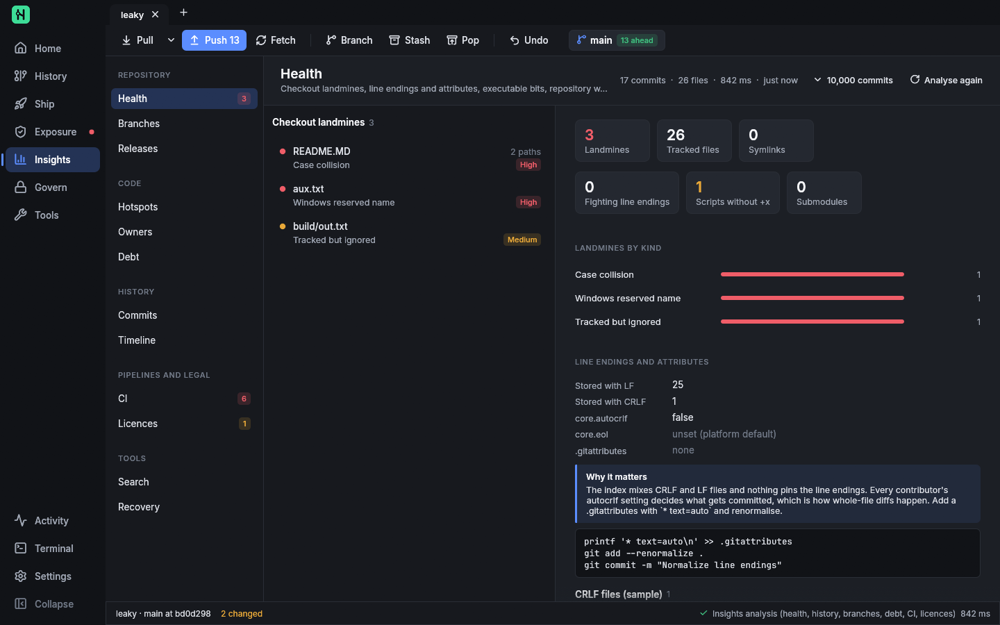
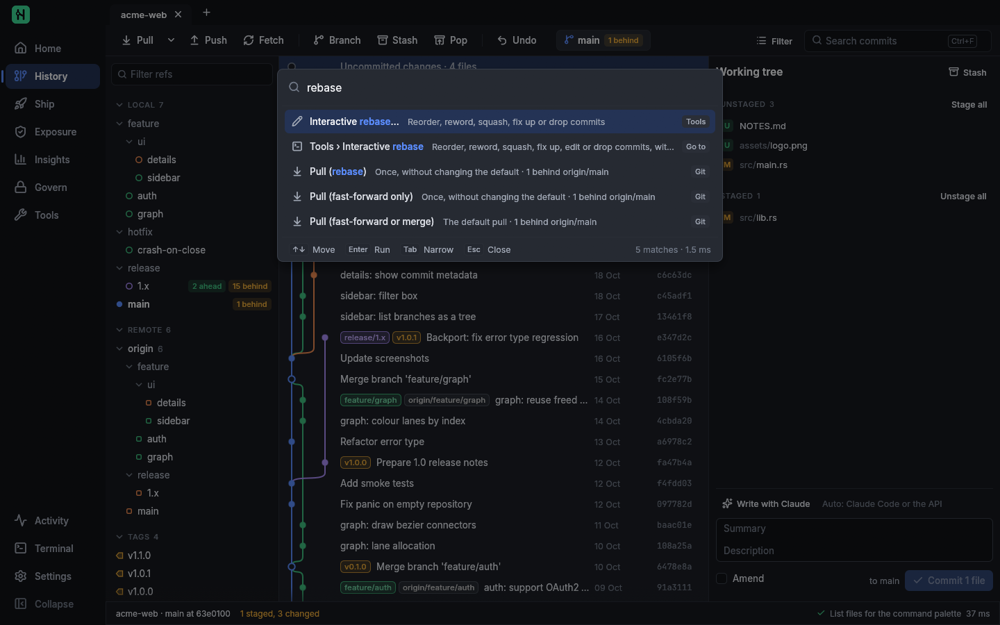
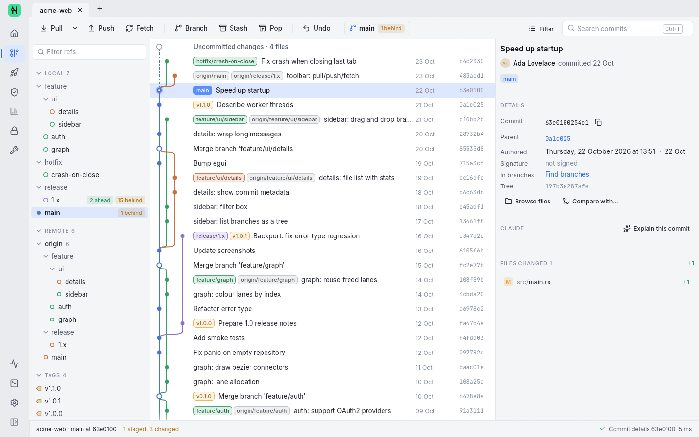

<picture>
  <source media="(prefers-color-scheme: dark)" srcset="docs/brand/svg/hadion-lockup.svg">
  
</picture>

**A fast, native Git client that makes your branches easy to see.**

Pull requests, CI runs, releases, containers and security checks sit in the same window, so
you can follow a change from your first commit to production without switching tools.
Hadion is free and open source, written in Rust.

**[Download for Windows](https://github.com/saziknows/hadion-gui/releases/latest)** ·
[All features](docs/features.md) · [Changelog](CHANGELOG.md)



## Why Hadion

- **See your branches.** Every branch keeps its colour, and even a 100,000-commit history
  scrolls smoothly.
- **Real git underneath.** Every change runs through your own `git`, so hooks, signing and
  your settings work exactly as they do on the command line.
- **Nothing hidden.** The activity log lists every command Hadion ran. Anything that changes
  a server shows you the exact command first.
- **The work around the code.** Reviews, CI, releases, containers and secret scanning are one
  click away.

## A quick tour

### History and branches

Drag a branch onto another to merge or rebase it. Stage single lines, and undo almost
anything with `Ctrl+Z`.

### Merge conflicts

Your side, the result and their side, next to each other. Pick a side for each conflict, or
edit the result yourself.



### Pull requests

Read the changes, comment on lines, suggest edits, approve and merge. Hadion uses your own
`gh` login and stores no token.



### CI runs

Follow runs, jobs and full logs. Re-run what failed, or compare a failure with the last run
that passed.



### Containers

See the containers of the project you have open: their health and logs, a shell, and which
commit each one is running.



### Exposure

Find passwords and keys in your files, your staged changes and your whole history. Hadion
tells you whether a secret was pushed, and what to do about it.



### Insights

Things git knows that other clients don't show: files that break checkouts, hotspots,
owners, stale branches, risky workflows and licence problems.



### Command palette

Press `Ctrl+K` to search commands, branches, pull requests, files and commits in one place.



### Your layout

Light or dark theme. Press `Ctrl+B` to collapse the sidebar to icons.



## Install

**Windows** (x86-64): download the installer or the zip from
[Releases](https://github.com/saziknows/hadion-gui/releases). The installer needs no
administrator rights, and lets Hadion update itself. Each release lists its checksums in
`SHA256SUMS`.

You need [git](https://git-scm.com/). Other tools are optional: Hadion tells you when a
feature needs one, and how to install it.

| Tool | Used for |
| --- | --- |
| [`gh`](https://cli.github.com/) | GitHub: pull requests, CI, releases |
| `glab`, `az` | GitLab and Azure DevOps |
| `docker` | Containers |
| `kubectl`, `terraform` / `tofu` | Kubernetes and Terraform |
| `act`, `trivy` / `grype` | Running workflows locally, scanning images |
| `claude` | AI help with your Claude plan |

**Platforms.** Hadion is used every day on Windows 11. Linux builds and passes the tests, but
its interface has seen little use there. macOS has not been tried yet.

## Build from source

You need Rust (stable), a C compiler and git.

```sh
cargo run --release -p hadion -- path/to/repo
cargo test
```

[docs/development.md](docs/development.md) covers tests, benchmarks, packaging and how the code
is organised.

## Keyboard shortcuts

| Keys | Action |
| --- | --- |
| `Ctrl+K` | Command palette |
| `Ctrl+F` | Search commits |
| `Ctrl+Z` | Undo the last change to HEAD |
| `Ctrl+B` | Collapse or expand the sidebar |
| `Ctrl+L` | Activity log |
| `` Ctrl+` `` | Terminal |
| `Ctrl+,` | Settings |
| `F5` | Reload the repository |

Every shortcut is listed in [docs/features.md](docs/features.md#keyboard).

## Status

Version 0.1: early, but used every day. [docs/features.md](docs/features.md#known-gaps) lists
what is not done yet.

## Contributing

Bug reports, ideas and pull requests are welcome; see [CONTRIBUTING.md](CONTRIBUTING.md).
Please report security problems privately, as [SECURITY.md](SECURITY.md) describes.

## License

Hadion is licensed under either the [Apache License 2.0](LICENSE-APACHE) or the
[MIT license](LICENSE-MIT), at your option. Unless you say otherwise, any contribution you
submit is licensed the same way.

The bundled Inter and JetBrains Mono fonts use the SIL Open Font License 1.1, and the Lucide
icons the ISC licence; their licence files are in `crates/hadion/assets/fonts`. Every release
lists the licences of the crates it is built from in `licenses/THIRD-PARTY-LICENSES.txt`. The
logo files and the rules for using them are in [`docs/brand`](docs/brand).
